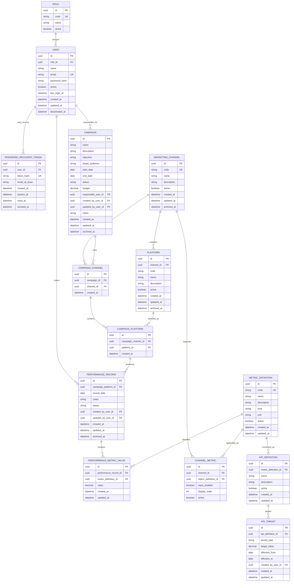

# Preliminary Entity Relationship Diagram

**Project:** Digital Marketing Performance Analytics and Monitoring System  
**Version:** 1.0  
**Status:** Approved  
**Phase:** Step 2 — Domain & Data Model

## 1. Logical ERD

The 2026-10-08 [reporting currency addition](../decisions/ADR-009-reporting-currency-settings.md) adds a standalone singleton `ReportingSettings` table (`id`, nullable `reportingCurrency`, `updatedAt`) with no foreign keys. Existing relationships below remain unchanged.



## 2. Important Logical Unique Constraints

```text
ROLE(code)

USER(email)

MARKETING_CHANNEL(code)

PLATFORM(channel_id, code)

CAMPAIGN_CHANNEL(campaign_id, channel_id)

CAMPAIGN_PLATFORM(campaign_channel_id, platform_id)

CHANNEL_METRIC(channel_id, metric_definition_id)

PERFORMANCE_RECORD(campaign_platform_id, record_date)
  for active/non-archived rows

PERFORMANCE_METRIC_VALUE(performance_record_id, metric_definition_id)

METRIC_DEFINITION(code)
```

## 3. Important Relationship Validation

Some integrity rules cross more than one table and may require application-level validation or advanced database constraints.

### CampaignPlatform channel consistency

Given:

```text
CampaignPlatform
  → CampaignChannel
      → MarketingChannel A

CampaignPlatform
  → Platform
      → MarketingChannel B
```

A valid row requires:

```text
MarketingChannel A = MarketingChannel B
```

### Performance metric applicability

Given:

```text
PerformanceRecord
  → CampaignPlatform
  → CampaignChannel
  → MarketingChannel
```

a stored metric must exist in:

```text
ChannelMetric(channel, metric)
```

and must be a RAW input metric.

## 4. Not Yet Modelled

The following are intentionally deferred:

- exact KPI-target scope dimensions
- comparator rules
- audit log
- authentication sessions
- deployment-specific infrastructure
- third-party integrations
- persistent generated reports
- notifications
