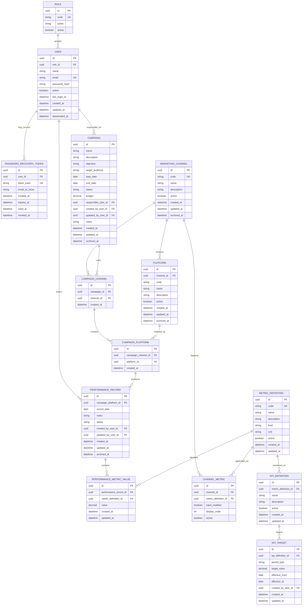
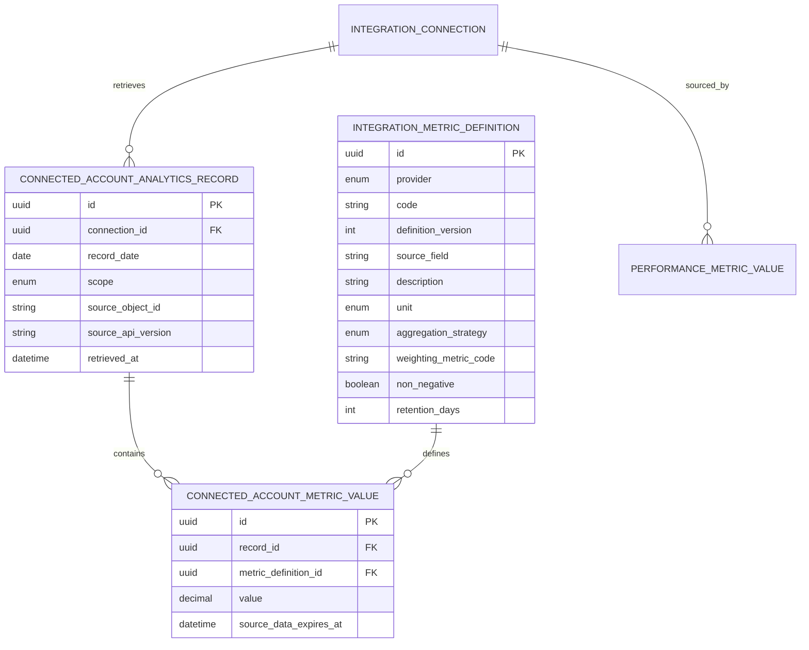
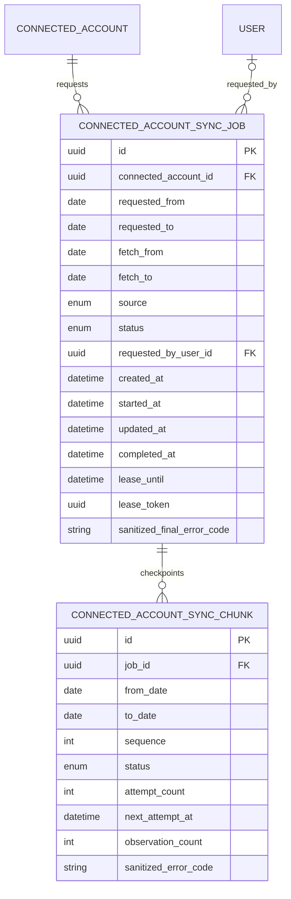

# Preliminary Entity Relationship Diagram

**Project:** Digital Marketing Performance Analytics and Monitoring System  
**Version:** 1.0  
**Status:** Approved  
**Phase:** Step 2 — Domain & Data Model

## 1. Logical ERD

The 2026-10-08 [integration addition](../decisions/ADR-011-live-integrations.md) adds `Platform → IntegrationConnection → IntegrationMapping / IntegrationRun`, with each mapping referencing exactly one campaign-platform (which has at most one mapping). Performance records may reference a mapping while retaining existing daily uniqueness. Connections reference their configuring user. All new foreign keys preserve historical references; credential values are absent from the schema.

The 2026-10-08 [reporting currency addition](../decisions/ADR-009-reporting-currency-settings.md) adds a standalone singleton `ReportingSettings` table (`id`, nullable `reportingCurrency`, `updatedAt`) with no foreign keys. Existing relationships below remain unchanged.



## 2. Important Logical Unique Constraints

```text
ROLE(code)

USER(email)

MARKETING_CHANNEL(code)

PLATFORM(channel_id, code)

CAMPAIGN_CHANNEL(campaign_id, channel_id)

CAMPAIGN_PLATFORM(campaign_channel_id, platform_id)

CHANNEL_METRIC(channel_id, metric_definition_id)

PERFORMANCE_RECORD(campaign_platform_id, record_date)
  for active/non-archived rows

PERFORMANCE_METRIC_VALUE(performance_record_id, metric_definition_id)

METRIC_DEFINITION(code)
```

## 3. Important Relationship Validation

Some integrity rules cross more than one table and may require application-level validation or advanced database constraints.

### CampaignPlatform channel consistency

Given:

```text
CampaignPlatform
  → CampaignChannel
      → MarketingChannel A

CampaignPlatform
  → Platform
      → MarketingChannel B
```

A valid row requires:

```text
MarketingChannel A = MarketingChannel B
```

### Performance metric applicability

Given:

```text
PerformanceRecord
  → CampaignPlatform
  → CampaignChannel
  → MarketingChannel
```

a stored metric must exist in:

```text
ChannelMetric(channel, metric)
```

and must be a RAW input metric.

## 4. Not Yet Modelled

The following are intentionally deferred:

- exact KPI-target scope dimensions
- comparator rules
- audit log
- authentication sessions
- deployment-specific infrastructure
- third-party integrations
- persistent generated reports
- notifications

## 5. Connected-account analytics extension (2026-10-14)

The following additive relationships support data whose source grain is a connected account or content object. They remain separate from `PerformanceRecord` and campaign KPI calculations.



Unique keys are `(provider, code, definition_version)` for provider metrics, `(connection_id, record_date, scope, source_object_id)` for observations, and `(record_id, metric_definition_id)` for values. LinkedIn reporting values carry a source expiry; the API excludes expired values and deletes them through the provider-specific retention worker. Details: [ADR-012](../decisions/ADR-012-connected-account-analytics.md).

## 2026-10-18 additions

Role has many UserInvitation rows (restrictive role reference). RegistrationRequest retains resolution actor and approved-user identifiers as historical evidence. ArchiveDeletionConfirmation and DeletedPerformanceKey intentionally retain entity identifiers without entity foreign keys so confirmation consumption and deletion evidence survive entity removal. Existing entity relationships are unchanged; no organization or tenancy entity is introduced.

## 2026-10-20 connected-account sync jobs



At most one queued or running job can exist for a connected account. Chunk sequence is unique within a job and ordered newest to oldest. Jobs contain no credentials or raw provider responses and are retained for 30 days after completion. See [ADR-012](../decisions/ADR-012-connected-account-analytics.md) for the lifecycle and retention boundary.
