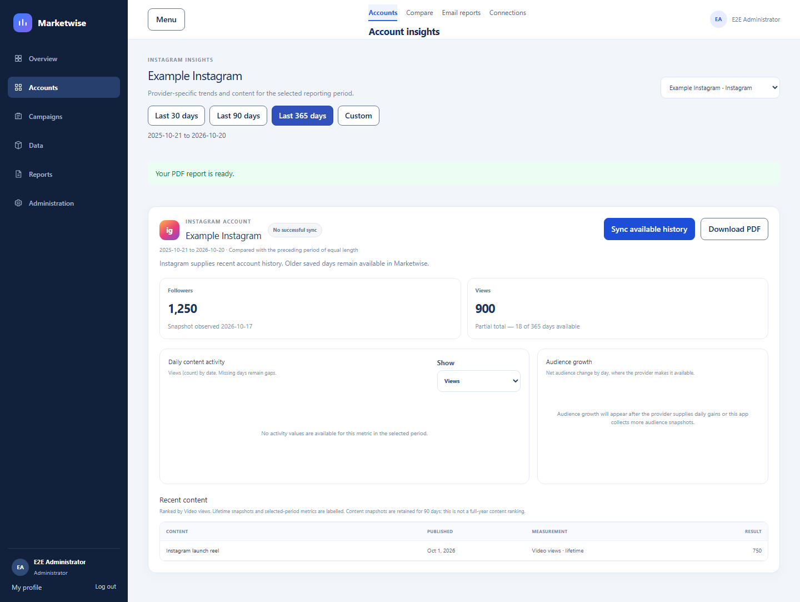
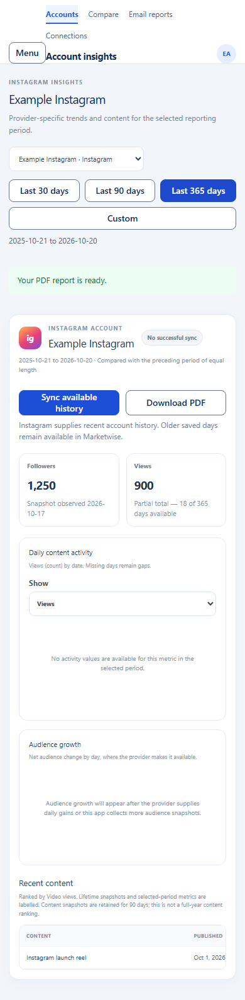

# Meta one-year account reports — verification

**Verification date:** 2026-10-20
**Scope:** Instagram and Facebook connected-account reports and background history sync.

## Implemented behavior

- Reports accept up to 365 inclusive calendar dates; `Last 365 days` begins at `today − 364 days` in the configured reporting timezone. A 366-day range is rejected.
- Saved observations can be reported across the selected year. Instagram fetch jobs are clipped to its latest 90-day history window and use one-day chunks. Facebook can request the selected year in chunks of up to 30 days.
- Meta account metrics retain for 365 days from retrieval. Post snapshots retain their existing 90-day period. The additive migration extends only matching account values that were not yet expired when it runs; it does not revive expired data.
- Durable PostgreSQL jobs expose queue/progress/status, resume after an expired lease, and keep successful chunks. Historical reports distinguish missing values from zero. Current follower snapshots are stored on retrieval date, not backdated.
- The account dashboard reads saved values immediately, explains partial coverage, shows background sync progress, and keeps recent post retention separate from annual account history.

## Verification results

All checks below passed on the current working tree:

| Check                          | Result                                     |
| ------------------------------ | ------------------------------------------ |
| `pnpm lint`                    | Passed                                     |
| `pnpm typecheck`               | Passed                                     |
| `pnpm test:unit`               | Passed — 128 tests in 29 files             |
| `pnpm test:integration`        | Passed — 84 tests in 11 files              |
| `pnpm build`                   | Passed — API and Next.js production builds |
| `pnpm format:docs`             | Passed                                     |
| Isolated Playwright E2E runner | Passed — all 24 browser journeys           |
| `git diff --check`             | Passed                                     |

The focused account report journey also passed after verifying the `Last 365 days` preset, partial-coverage text, queued sync progress, PDF download, comparison behavior, and mobile layout. The full E2E run includes campaign/import and role-specific browser journeys.

E2E used the repository's guarded local test database and temporary ports 4201/3101. Its test migration and fixtures did not use the development database or imported campaign files. The isolated Next.js production build and both temporary servers completed successfully; the runner stopped its own servers afterward.

## Screen review

Reviewed the account report at 1440×900 and 390×844. At both sizes the selected year is clear and missing history is shown as a partial total. The mobile preset and actions wrap without horizontal document overflow. The larger viewport keeps the metric tiles, activity chart, audience panel, and recent content readable.

## Limits and rollout

- Browser and integration checks use fixtures; they do not demonstrate that Meta will return a complete year for a live account. Instagram's fetch window is limited to recent history, while Facebook metric availability can vary by metric.
- No external deployment or live provider year-history backfill was performed. Apply the additive migration using the normal production backup and migration workflow before deploying the worker/frontend. Keep the existing scheduler enabled only after migration succeeds.
- The integration/browser run emitted an existing `pg` deprecation warning about overlapping `client.query()` execution in the auth test path. It did not fail any test and is unrelated to the Meta report change.
- LinkedIn, YouTube, Zoho, campaign imports, metric definitions outside Meta account metrics, and provider permissions were not changed.
