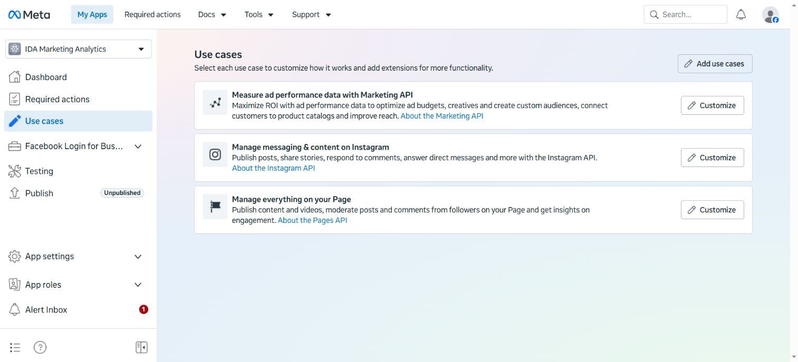

# Marketwise: installation and provider setup, step by step

Updated 19 October 2026. This guide configures **Accounts → Connect**.

## 1. Before starting

Moving to another computer does not require new developer apps. Reuse the existing apps if the same organisation owns the new installation. Add the new callback URL to each console. Create new apps only for a different owner or when the original apps are unavailable.

What we confirmed:

- Meta app **IDA Marketing Analytics**, main app ID **1557681759712876**. The saved use cases are shown below.
- Separate Instagram-login app **IDA Marketing Analytics-IG**, ID **1584424522873295**. Our current Facebook-login code uses the main Meta app, not this separate ID.
- Facebook consent succeeded. The owner has no Facebook Page, so Facebook/Instagram metrics were not verified. A successful consent screen does not create a Page.
- YouTube and Zoho show successful sync timestamps in Accounts.
- LinkedIn was configured earlier, but the current Accounts screen reports **API setup needed**. Follow its full configuration and approval checks below; a current successful LinkedIn sync is not established by our evidence.



Captured from the browser on 19 October 2026, without secrets. Console labels can change; the Meta use-case names here were observed directly. Other provider steps follow their official documentation and this application's actual configuration.

## 2. Write down your addresses

| Name              | Meaning                              | Local example                                       |
| ----------------- | ------------------------------------ | --------------------------------------------------- |
| Web origin        | Website users open                   | `http://localhost:3000`                             |
| API origin        | Backend server                       | `http://localhost:4000`                             |
| Accounts callback | Where providers return after consent | `https://<api-host>/api/v1/accounts/oauth/callback` |

Our development callback was:

```text
https://talisman-large-proactive.ngrok-free.dev/api/v1/accounts/oauth/callback
```

That tunnel forwards to **API port 4000**, not website port 3000. Verify it is still active before reusing it. A hosted HTTPS API replaces ngrok.

For a Render deployment, use the public HTTPS **web origin** for callbacks. The browser calls the web service at `/api/v1/...`; Next.js proxies the request to the API service so cookies stay on the web origin. Do not register the separate API hostname as the callback for this deployment. The exact Render setup is in the [Render deployment guide](render-deployment.md).

The callback must match exactly in the backend and every provider console: scheme, hostname, port if present, and path. This callback has no trailing slash.

## 3. Install on the new system

1. Install [Git](https://git-scm.com/downloads).
2. Install [Node.js](https://nodejs.org/) version **24 or later**.
3. Open a new PowerShell window. Run `node --version`; confirm major version 24 or above.
4. Install the required package manager:

   ```powershell
   npm install --global pnpm@11.8.0
   pnpm --version
   ```

5. Install PostgreSQL or obtain a managed PostgreSQL database. Keep its credentials private.
6. Open PowerShell in the parent folder where the app should live.
7. Run:

   ```powershell
   git clone git@github.com:tolukusan/social-media-dashboard.git
   cd social-media-dashboard
   git switch main
   git pull --ff-only origin main
   pnpm install --frozen-lockfile
   ```

8. If SSH is unavailable, use the repository's HTTPS clone URL and GitHub authentication.
9. Open the cloned folder in your editor. Enable hidden-file visibility so you can see `.env` files.

### Preserve existing data or start fresh

To move the existing installation, back up PostgreSQL using `pg_dump`, transfer the backup securely, and restore to a verified new database. Copy the original ignored API configuration securely. Preserve `INTEGRATION_TOKEN_ENCRYPTION_KEY`: existing saved account tokens require that same key. Preserve `INTEGRATION_OAUTH_ENCRYPTION_KEY` too if older connector credentials exist. Back up keys and database together, outside Git.

For a fresh installation, create an empty application database and new keys. Old imports and connections will not appear in an empty database. Reconnect providers afterward.

Never run `prisma migrate reset`, demo-data commands, or test-database preparation against the application database.

## 4. Configure the API

1. Copy `apps/api/.env.example` to `apps/api/.env`.
2. Edit the copy. Do not commit it.
3. Fill these values, replacing placeholders privately:

   ```dotenv
   DATABASE_URL=postgresql://<user>:<password>@<host>:5432/<database>?schema=social_media_dashboard
   APP_ORIGIN=http://localhost:3000
   API_PORT=4000
   NODE_ENV=development
   REPORTING_TIMEZONE=Africa/Lagos
   SESSION_COOKIE_NAME=smd_session
   INTEGRATION_OAUTH_REDIRECT_URI=https://<public-web-host>/api/v1/accounts/oauth/callback
   INTEGRATION_TOKEN_ENCRYPTION_KEY=<base64-key>
   INTEGRATIONS_SCHEDULER_ENABLED=true
   ```

4. URL-encode special characters in database passwords used in a connection string.
5. For a fresh database only, generate the encryption key below and copy its output privately into the setting. For a migrated database, reuse the original key instead.

   ```powershell
   node -e "console.log(require('node:crypto').randomBytes(32).toString('base64'))"
   ```

6. Keep one authoritative entry for each variable. The example contains repeated legacy settings; remove duplicate entries in your private copy so a later empty value cannot override a filled value.
7. Add provider variables from sections 7–10. Never put secrets in `NEXT_PUBLIC_` variables.
8. Save. Restart the API whenever you change its environment.

The API loads `.env` from its working directory. Use package-filter commands below, or start it with working directory `apps/api`.

### Tables and first administrator

From the repository root:

```powershell
pnpm --filter @smd/api prisma:generate
pnpm --filter @smd/api exec prisma migrate deploy
```

For a fresh local database only, set `SEED_ADMIN_EMAIL` and a strong `SEED_ADMIN_PASSWORD` in the API's private environment, then run:

```powershell
pnpm --filter @smd/api prisma:seed
```

Remove the seed password from the environment afterward. Existing installations should use their existing administrator. In production, the seed creates an Administrator only if none exists and skips an existing one; use the temporary Render initialization command in the [Render guide](render-deployment.md). Do not create demo data in production. Select reporting currency in Administration after login.

## 5. Start locally and check the tunnel

1. Create `apps/web/.env.local`.
2. Add:

   ```dotenv
   NEXT_PUBLIC_API_URL=http://localhost:4000/api/v1
   ```

3. In the repository root run `pnpm dev`. Leave the terminal running.
4. Open `http://localhost:4000/api/v1/health`. It must return HTTP 200 and a health response.
5. Open `http://localhost:3000`, sign in, and open **Accounts**.
6. Install ngrok and sign in to your ngrok account. Complete its account-provided authtoken command privately.
7. In another terminal run `ngrok http 4000`.
8. Copy the HTTPS forwarding address.
9. Open `https://<forwarding-address>/api/v1/health`. Continue only when it reaches the backend.
10. Set API `INTEGRATION_OAUTH_REDIRECT_URI` to that address plus `/api/v1/accounts/oauth/callback`.
11. Register that full callback in all provider consoles below.
12. Restart the API. Keep the tunnel running throughout consent.
13. If the tunnel address changes, update backend and consoles again, then restart.

If the website is blank, inspect the terminal before changing provider permissions. Do not build into a live development server's `.next` directory; stop it first or use an isolated build directory.

## 6. Accounts and older connectors are separate

This guide uses **Accounts → Connect**, whose callback is `/api/v1/accounts/oauth/callback`.

Older campaign/marketing connectors use `INTEGRATION_META_OAUTH_CLIENT_ID`, `INTEGRATION_LINKEDIN_OAUTH_CLIENT_ID`, `INTEGRATION_GOOGLE_OAUTH_CLIENT_ID`, and `INTEGRATION_ZOHO_OAUTH_CLIENT_ID`, matching secret variables, and separate callback routes:

```text
/api/v1/integrations/oauth/meta/callback
/api/v1/integrations/oauth/linkedin/callback
/api/v1/integrations/oauth/google/callback
/api/v1/integrations/oauth/zoho/callback
```

Those older flows also use stable `INTEGRATION_OAUTH_ENCRYPTION_KEY`, public `INTEGRATION_OAUTH_API_ORIGIN`, and `INTEGRATION_OAUTH_ALLOWED_CALLBACK_ORIGINS`. Register their callbacks only if using those flows. Filling only their variables does not make Accounts ready. Administrator-managed access tokens are another distinct configuration; they are not client secrets. See [integration guide](integrations.md).

## 7. Facebook and Instagram

### 7.1 Open the main app

1. Open [Meta for Developers](https://developers.facebook.com/).
2. Log in with the identity administering the app. Complete developer registration or identity checks if prompted.
3. Click **My Apps**.
4. Select **IDA Marketing Analytics**, main ID **1557681759712876**. Do not select TradePadi or the separately generated Instagram-login app.
5. For a different owner: choose **Create App**, enter its name/contact email, select its business portfolio when requested, and complete the business/use-case creation flow. Use its new main ID with its own secret, not our ID.

### 7.2 Add the exact use cases

1. Click **Use cases** in the left navigation.
2. The existing app has:
   - **Measure ad performance data with Marketing API**.
   - **Manage messaging & content on Instagram**.
   - **Manage everything on your Page**.
3. Click **Add use cases** for missing items.
4. Select **All** in the filter if needed.
5. Tick the Instagram and Page use cases, then click **Save**.
6. Return to Use cases and confirm the cards appear. Ticking without saving is insufficient.
7. Marketing performance was already present in our app. It supports a separate marketing workflow; organic Accounts reporting still needs the permissions below.

### 7.3 Switch Instagram setup to Facebook login

1. On **Manage messaging & content on Instagram**, click **Customize**.
2. Confirm the top selector reads **Instagram API**.
3. Click **API setup with Facebook login** in the left menu.
4. Do not remain on **API setup with Instagram login**. That flow produces the `...-IG` app and `instagram_business_*` permissions. Our code uses Facebook login and the main Meta app.
5. Under **Add required permissions**, add missing required permissions.
6. Open **Permissions and features**, or click **Go to permissions and features**.
7. Find `instagram_manage_insights`, click **Add** when offered, and confirm it is available for testing. Our screen showed **Ready for testing**.
8. Confirm `instagram_basic`, `pages_show_list`, and `pages_read_engagement` are added too.
9. The wizard may list publishing/messaging permissions; those are not the analytics scope list used by Accounts below.

### 7.4 Add Page insights

1. Return to **Use cases**.
2. Click **Customize** on **Manage everything on your Page**.
3. Open its **Permissions and features**.
4. Find `read_insights` and add it where offered.
5. Check `pages_show_list` and `pages_read_engagement` availability too.
6. If unavailable or review-gated, inspect eligibility/access requirements. Do not remove scopes from code merely to suppress errors.

Exact scopes requested by this application:

| Connection | Scopes                                                              |
| ---------- | ------------------------------------------------------------------- |
| Facebook   | `pages_show_list`, `pages_read_engagement`, `read_insights`         |
| Instagram  | All three above plus `instagram_basic`, `instagram_manage_insights` |

Our first error named `read_insights`, `instagram_basic`, and `instagram_manage_insights`. After adding Instagram setup, `instagram_basic` disappeared from the error. Adding the remaining analytics permissions resolved the consent blocker.

### 7.5 Save the real OAuth callback

1. Expand **Facebook Login for Business** in the left menu.
2. Click its **Settings**.
3. Enable **Client OAuth Login** and **Web OAuth Login** where those switches are offered.
4. Find **Valid OAuth Redirect URIs**.
5. Paste the complete Accounts callback from section 2 or 5.
6. Click **Save changes**.
7. Use the Redirect URI Validator if offered, with exactly the same URL.
8. Keep HTTPS and strict redirect protections enabled.
9. Do not substitute **App settings → Advanced → Authorize callback URL**. A WhatsApp webhook configured there does not register Facebook's login redirect.

### 7.6 Set credentials privately

1. Open **App settings → Basic**.
2. Copy the main App ID into `INTEGRATION_META_APP_ID`.
3. Reveal/copy its secret privately into `INTEGRATION_META_APP_SECRET`.
4. Set `INTEGRATION_META_API_VERSION` to the supported Graph version chosen for the app, including the `v` prefix. Our consent URL used `v26.0`; verify availability in your app before reusing it later.
5. Save API configuration and restart the API.
6. Do not screenshot the revealed secret or put it in the frontend.

### 7.7 Create/link eligible assets

1. Sign in to Facebook with the consenting identity.
2. Open **Pages**. Select a Page you administer or create the organisation's Page through Facebook's Page creation flow.
3. Verify the identity has Page access sufficient to view insights. Personal-profile login alone cannot supply Page metrics.
4. For Instagram, open its settings and switch a personal account to a **Business** or **Creator** professional account.
5. In Facebook Page settings locate **Linked accounts → Instagram**, or the linked-account setting in Meta Business Suite.
6. Choose **Connect account**, sign in to the intended Instagram identity, and approve the link.
7. Verify the correct Instagram handle appears on the Page afterward.
8. In developer **App roles → Roles**, ensure testing users have the required app role and accept invitations.
9. Our app is unpublished. Public use outside permitted roles requires Meta's applicable business verification, permission access/review, privacy policy, data-deletion information, and publishing steps. **Ready for testing** is not public approval.

### 7.8 Connect and verify

1. Open Marketwise **Accounts**.
2. Confirm the provider no longer says **API setup needed**.
3. Click its **Connect** action.
4. Log in with the Page administrator.
5. Select the intended business/Page/Instagram assets and approve read permissions.
6. Finish consent, including **Got it** if displayed.
7. Expect the public API callback, followed by a return to the configured web origin.
8. Confirm an account card appears, run an update, and inspect the successful-update timestamp.
9. If consent succeeds but no account appears, revisit Page existence/access and Instagram linking. Our no-Page situation stops here until a Page exists.

References: [Pages API](https://developers.facebook.com/docs/pages-api/), [Instagram with Facebook Login](https://developers.facebook.com/docs/instagram-platform/instagram-api-with-facebook-login/), [Facebook Login for Business](https://developers.facebook.com/docs/facebook-login/facebook-login-for-business/).

## 8. LinkedIn

1. Open [LinkedIn Developers](https://www.linkedin.com/developers/apps) and sign in.
2. Select the existing organisation app. Its historical name/ID was not retained in our evidence; identify it by owner, associated Page, and client ID privately. Do not invent an ID.
3. For a new owner choose **Create app**, enter its name, associated LinkedIn Page, privacy-policy URL, and required contact/branding information.
4. Complete app/Page verification. Ask the Page administrator to approve verification if required.
5. Open **Products**.
6. Enable/request **Sign In with LinkedIn using OpenID Connect** for `openid` and `profile`.
7. Request **Community Management API** access. Complete its application/access-tier process and wait for approval. A client ID or Share on LinkedIn alone does not provide organisation analytics.
8. Open **Auth**.
9. Add the exact shared Accounts callback to authorised redirect URLs and save.
10. Copy credentials privately into:

    ```dotenv
    INTEGRATION_LINKEDIN_CLIENT_ID=<client-id>
    INTEGRATION_LINKEDIN_CLIENT_SECRET=<client-secret>
    INTEGRATION_LINKEDIN_API_VERSION=<supported-YYYYMM>
    ```

11. The API version is a supported six-digit release, not `v2` and not an invented current month. Check LinkedIn's supported versions before choosing it.
12. Confirm approved products grant all requested scopes: `openid`, `profile`, `rw_organization_admin`, `r_organization_social`.
13. Ensure the consenting member administers the intended organisation Page.
14. Restart the API. Accounts should show configuration ready.
15. Click **Connect**, consent, and confirm the correct organisation appears.
16. Run an update. Consent alone does not prove reporting access.
17. If **API setup needed** persists, check all three variables plus shared redirect/encryption configuration. This was the present screen state during guide preparation.

`rw_organization_admin` is the provider's scope name; this application uses read endpoints. Product approval, Page roles, and API version support are separate checks.

References: [quick start](https://learn.microsoft.com/en-us/linkedin/marketing/quick-start), [Community Management](https://learn.microsoft.com/en-us/linkedin/marketing/community-management/community-management-overview), [versioning](https://learn.microsoft.com/en-us/linkedin/marketing/versioning).

## 9. YouTube / Google

1. Open [Google Cloud Console](https://console.cloud.google.com/) and sign in with the project owner.
2. In the project selector choose the project containing the existing OAuth client. For a new owner choose **New project**. The historical project ID was not retained; verify ownership/client ID privately rather than creating duplicates.
3. Open **APIs & Services → Library**.
4. Search **YouTube Data API v3**, open it, and click **Enable**.
5. Return to Library. Search **YouTube Analytics API** and enable it too.
6. Confirm both appear under **Enabled APIs & services**. Data API alone is insufficient.
7. Open **Google Auth Platform**. If prompted click **Get started** and enter app name, support email, audience, and developer contact.
8. Under **Audience**, choose the appropriate Internal/External audience. For External testing, add the exact connecting Google identity as a **Test user** and save.
9. Under **Branding**, complete required application/domain/privacy information.
10. Under **Data Access**, configure these scopes when requested:

    ```text
    https://www.googleapis.com/auth/youtube.readonly
    https://www.googleapis.com/auth/yt-analytics.readonly
    ```

11. Open **Clients → Create client → Web application**. Older navigation calls this **APIs & Services → Credentials → Create credentials → OAuth client ID**.
12. Give the client a clear name, for example `Marketwise web server`.
13. Under **Authorized redirect URIs**, add the full shared Accounts callback. Save/create.
14. If using an authorised-origin field, enter the web origin there. It does not replace the full backend redirect URI.
15. Copy client ID/secret privately into:

    ```dotenv
    INTEGRATION_GOOGLE_CLIENT_ID=<web-client-id>
    INTEGRATION_GOOGLE_CLIENT_SECRET=<web-client-secret>
    ```

16. Restart the API. Open **Accounts → YouTube → Connect**.
17. Choose the Google identity that manages the intended channel. If a Brand Account/channel picker appears, select the correct channel identity.
18. Approve both read permissions and finish consent.
19. Confirm the channel card appears and run an update. Our connected channel was **Luke Skywalker** (`@lukeskywalker-cc2lw`).
20. Confirm the successful-update timestamp. Empty activity is different from failed authorisation.
21. For public use, complete Google's applicable verification/publishing requirements. Testing refresh tokens may expire under Google's testing rules; changing a callback does not fix that.

An API key or service account is not a substitute for channel-owner OAuth.

Reference: [YouTube authorisation credentials](https://developers.google.com/youtube/reporting/guides/registering_an_application).

## 10. Zoho Campaigns

1. Sign in to the Zoho account owning the required **Campaigns** reports. CRM access alone is insufficient.
2. Identify its data centre from the account/service hostname.
3. Open the matching regional API console. For US use [api-console.zoho.com](https://api-console.zoho.com/).

   | Backend region | Domain family |
   | -------------- | ------------- |
   | `US`           | `zoho.com`    |
   | `EU`           | `zoho.eu`     |
   | `IN`           | `zoho.in`     |
   | `AU`           | `zoho.com.au` |
   | `JP`           | `zoho.jp`     |
   | `CN`           | `zoho.com.cn` |

4. Open the existing client, or choose **Add Client → Server-based Applications → Create now** for a new owner.
5. Enter a clear client name, for example `Marketwise Campaigns reporting`.
6. Set **Homepage URL** to the web URL.
7. Set **Authorized Redirect URIs** to the full shared Accounts callback.
8. Save/create the client.
9. Copy its credentials privately into:

   ```dotenv
   INTEGRATION_ZOHO_CLIENT_ID=<client-id>
   INTEGRATION_ZOHO_CLIENT_SECRET=<client-secret>
   INTEGRATION_ZOHO_REGION=US
   ```

10. Replace `US` with the actual supported uppercase region above. Account, client, and API setting must agree.
11. Restart API. Open **Accounts → Zoho Campaigns → Connect**.
12. Sign in to the correct Campaigns organisation and consent to `ZohoCampaigns.campaign.READ`.
13. Complete the redirect, confirm the email-reporting account card, and run an update.
14. Confirm the successful-update timestamp and accessible campaign reports.

Use a server-based client for this interactive flow. Self Client manually generated grants are a different process. Do not paste a grant code into a secret setting. Zoho figures are cumulative email-campaign snapshots, not daily social activity.

Reference: [Zoho app registration](https://www.zoho.com/developer/oauth/register-app.html).

## 11. Permanent HTTPS deployment

Use your host's documented domain/TLS and process-manager setup for the following application configuration.

1. Provision web/API services and PostgreSQL. Install Node/pnpm as above.
2. Assign same-site HTTPS web/API addresses.
3. Clone `main`, install the frozen lockfile, and securely supply API configuration.
4. Set API `NODE_ENV=production`, `APP_ORIGIN=https://<web-host>` and `INTEGRATION_OAUTH_REDIRECT_URI=https://<api-host>/api/v1/accounts/oauth/callback`.
5. Set web `NEXT_PUBLIC_API_URL=https://<api-host>/api/v1` **before building**. It is embedded in the web build; changing it requires rebuilding.
6. Back up the database and run:

   ```powershell
   pnpm --filter @smd/api prisma:generate
   pnpm --filter @smd/api exec prisma migrate deploy
   pnpm build
   ```

7. Configure API process working directory `apps/api`, command `node dist/src/main.js`, with its private environment loaded.
8. Configure web process working directory `apps/web`, command `pnpm exec next start --port 3000`.
9. Route API hostname to port 4000 and web hostname to port 3000 through HTTPS ingress. Preserve `/api/v1` paths. Keep PostgreSQL private.
10. Verify public `/api/v1/health` returns 200.
11. Register the permanent shared callback in all four provider consoles. Retain old callbacks only for deliberately active environments.
12. Restart API after environment changes. Sign in through the permanent website and reconnect providers where needed.
13. Check account discovery and successful sync separately for each provider.
14. Configure restart-on-boot, stable secrets, database backups, and recovery access.
15. Configure authorised SMTP if password recovery is required.
16. Retire the old tunnel deliberately after success.

See [deployment runbook](deployment-runbook.md) for backup, rollback, and release checks. This document does not claim an external deployment has been performed.

## 12. Troubleshooting the problems we solved

| Symptom                                               | Check/fix                                                                                                   |
| ----------------------------------------------------- | ----------------------------------------------------------------------------------------------------------- |
| Invalid `instagram_basic` scope                       | Instagram use case, Facebook-login setup, main app credentials, permission readiness.                       |
| Invalid `read_insights` / `instagram_manage_insights` | Add Page insights and Instagram analytics permissions; inspect access level. Start fresh consent.           |
| Only `instagram_business_*` permissions shown         | Switch Instagram-login setup to Facebook-login setup for this implementation.                               |
| Redirect mismatch                                     | Exact HTTPS hostname/path in backend and console; save, restart, start a fresh connection.                  |
| Consent succeeds but no Page                          | Create/administer a Page; personal-profile consent alone cannot supply metrics.                             |
| No Instagram account                                  | Professional account, Page link, Page access, app role, scopes.                                             |
| Blank callback and blank public health                | API terminal, tunnel port 4000, active hostname, HTTP status, proxy path. Fix reachability first.           |
| Callback never returns to website                     | Inspect backend callback error and APP_ORIGIN. The public callback itself is expected.                      |
| Reopening callback fails                              | Codes/state expire and are single-use. Start Connect again; do not reuse the URL.                           |
| API setup needed                                      | Correct Accounts variable names, shared encryption/redirect, supported API version/region; restart backend. |
| LinkedIn forbidden after consent                      | Community Management approval, requested scopes, organisation-admin role, supported API version.            |
| Google testing/access blocked                         | Exact Test user, audience, correct project/client, both APIs enabled.                                       |
| YouTube has no channel                                | Correct channel/Brand Account identity, not an unrelated Google login.                                      |
| Zoho invalid client/grant                             | Matching region, server client, exact callback, fresh one-time code.                                        |
| Migrated tokens cannot decrypt                        | Restore original key paired with database or reconnect. Do not generate a new key over old tokens.          |
| Website calls old API                                 | Correct NEXT_PUBLIC_API_URL, rebuild and restart web.                                                       |
| Cross-domain login fails                              | Exact APP_ORIGIN, HTTPS, credentialed requests, same-site web/API deployment.                               |
| Successful sync with empty chart                      | Check provider activity/date availability; unavailable does not mean zero.                                  |

Never share callback query strings containing codes/state, access tokens, or revealed secrets. For support, share the route without its query string and the error code.

## 13. Final checklist

- [ ] Correct release, Node/pnpm, database and migrations.
- [ ] Existing data deliberately preserved or fresh database chosen.
- [ ] Stable encryption keys secured with recovery backup.
- [ ] Public health and HTTPS website work.
- [ ] Exact callback registered in all consoles.
- [ ] Meta main app/use cases, analytics permissions, Page and Instagram link checked.
- [ ] LinkedIn OpenID/Community Management approval and dated API version checked.
- [ ] Both Google APIs, Web client, audience/test users checked.
- [ ] Zoho server client and matching region checked.
- [ ] Each actual account discovered and synced; consent alone is not the success criterion.
- [ ] No secrets in Git, frontend, or screenshots.
- [ ] Backups, process restart, and administrator recovery handed over.
