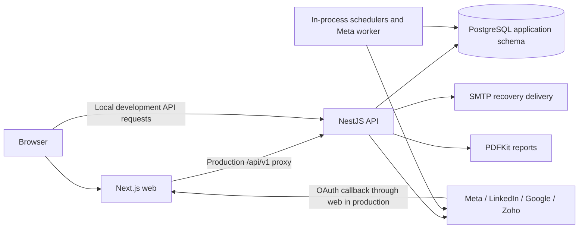
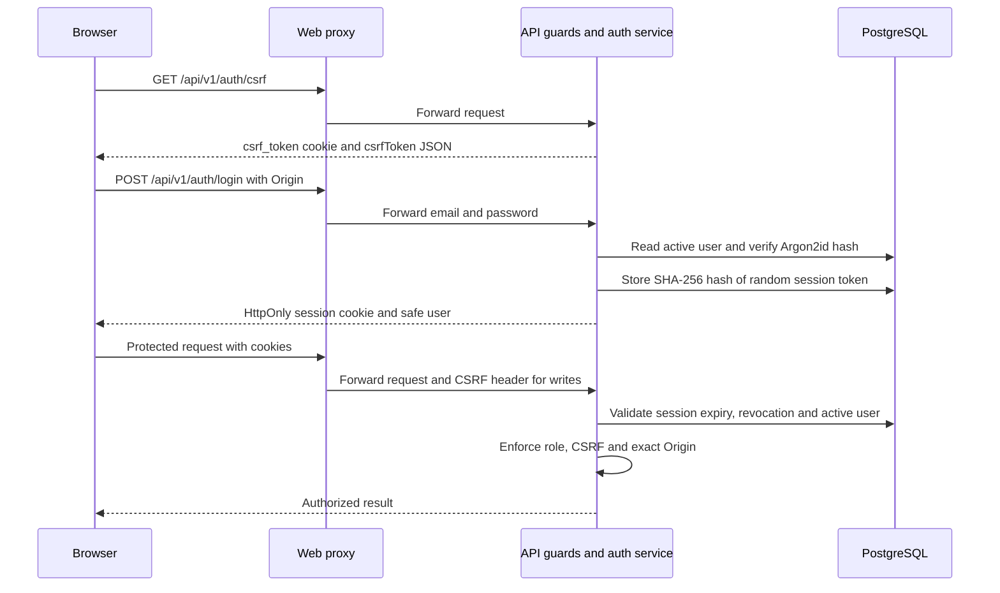
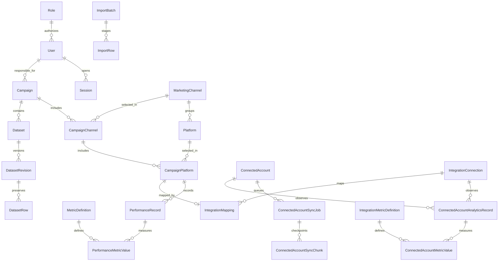

# Architecture

[Documentation home](README.md) · [API](API.md) · [Setup](SETUP.md) · [Deployment](DEPLOYMENT.md) · [Status](STATUS.md)

Snapshot: `20a364f`, reviewed 20 October 2026. The application is a Next.js frontend and a **NestJS modular monolith** sharing one PostgreSQL database. It has no Redis, external message broker or separate analytics database.

## Stack and versions

| Concern              | Actual implementation / supported baseline                                                                            |
| -------------------- | --------------------------------------------------------------------------------------------------------------------- |
| Runtime / workspace  | Node.js 24 LTS; root engine permits `>=24.0.0`, but later majors are not established as tested; pnpm pinned to 11.8.0 |
| Language             | TypeScript 5.9 family                                                                                                 |
| Frontend             | Next.js 15, React 19, App Router; Tailwind CSS 4 plus application CSS                                                 |
| UI data/forms/charts | TanStack Query 5, React Hook Form 7, Recharts 3                                                                       |
| API                  | NestJS 11, Express adapter, REST JSON under `/api/v1`                                                                 |
| Database             | PostgreSQL 18 baseline, Prisma 7 and `@prisma/adapter-pg`; schema `social_media_dashboard`                            |
| Files/reports        | `csv-parse` 7, ExcelJS 4, PDFKit 0.20; browser print for joined-dataset PDF                                           |
| Security             | Argon2id, opaque database-backed sessions, RBAC, Origin/CSRF guards; AES-256-GCM OAuth credential envelopes           |
| Verification         | Vitest 5, Playwright 1.55 family; PostgreSQL integration/restore runners and k6 load harness                          |

These are major families and selected package ranges, not a promise that all patches work. [Root manifest](../package.json), [API manifest](../apps/api/package.json), [web manifest](../apps/web/package.json) and [lockfile](../pnpm-lock.yaml) define reproducible installation. `pnpm install --frozen-lockfile` resolves the committed exact versions. The original [stack specification](../docs/architecture/tech-stack.md) includes planned OpenAPI and deferred report/provider choices; current source uses PDFKit and provider adapters and has no generated Swagger reference.

## Components and responsibilities

- `apps/web/app` owns public pages; `components` owns the workspace shell; `features` owns screens; `lib` owns transport/types and presentation helpers. Query state and permissions received from the API drive the UI. The browser never connects to PostgreSQL.
- `apps/api/src/app.module.ts` composes auth/access, users, archive, catalogues, campaigns, performance, analytics, targets, reports, imports, datasets, settings, integrations, connected accounts and account analytics. Services own authorization-sensitive domain operations, validation, calculations, transactions and auditing.
- `packages/shared` carries public contracts/constants. Prisma-generated source in `apps/api/src/generated` is build output.
- The API generates authoritative KPI/report results. The joined-file view does a browser-side date join and presentation only; it does not create campaign KPIs or aggregate rates.
- Next.js production rewrites require server-only `SMD_API_ORIGIN`; browser requests use `/api/v1`. Local development normally uses the explicit localhost API URL. See [proxy configuration](../apps/web/next.config.ts).

## Authentication and OAuth

Sessions currently expire after seven days in `AuthService`; the example `SESSION_TTL_DAYS` variable is not read. `Secure` cookies depend on `NODE_ENV=production`; session cookies use `HttpOnly`, `SameSite=Lax` and path `/`. Logout revokes the session. Own-password change, recovery, deactivation and administrative reset revoke affected access. Rate-limit maps for public access/login/recovery are process-local; they are not a shared ingress limit.

Accounts OAuth begins through an authenticated Admin/Marketing Officer request, stores a hashed one-time state bound to that user, redirects to the provider, exchanges the returned code server-side, discovers eligible assets and encrypts credentials. The public shared callback is `/api/v1/accounts/oauth/callback`. It returns the browser to the web origin. Campaign connections have separate family callbacks and separate credential/state records and encryption key. See [ADR-004](../docs/decisions/ADR-004-database-sessions.md), [ADR-013](../docs/decisions/ADR-013-oauth-credential-lifecycle.md), and [API security](API.md#authentication-and-request-security).

## Four data paths

| Path                                | Storage / purpose                                                                                                           | Important boundary                                                                                                                                                                                                                     |
| ----------------------------------- | --------------------------------------------------------------------------------------------------------------------------- | -------------------------------------------------------------------------------------------------------------------------------------------------------------------------------------------------------------------------------------- |
| File-first campaign datasets        | `Dataset` → `DatasetRevision` → `DatasetRow`; staged with `ImportBatch`/`ImportRow`                                         | Preserves columns and typed cells. Editable labels/meaning/unit do not make arbitrary columns canonical metrics. Replacements are versioned. Joined CSV can be reimported deliberately.                                                |
| Daily campaign performance          | `PerformanceRecord` → `PerformanceMetricValue`; manual input, structured KPI imports and compatible mapped paid campaigns   | One campaign-platform/date key; raw values feed backend KPI formulas. Integration-managed records have ownership/conflict protections.                                                                                                 |
| Organic connected-account reporting | `ConnectedAccount` → `ConnectedAccountAnalyticsRecord` → `ConnectedAccountMetricValue`, using `IntegrationMetricDefinition` | Provider-specific account/content observations are separate from campaign KPIs. Records from campaign connections can also use this canonical account store. No assumption that similarly named cross-provider metrics are equivalent. |
| Zoho email reporting                | Same account analytics tables, `EMAIL_CAMPAIGN` scope, `CUMULATIVE` data scope and provider campaign identity               | Selected by **campaign sent date**, not retrieval date. Cumulative campaign totals are not daily social activity.                                                                                                                      |

Paid `FACEBOOK_ADS`, `INSTAGRAM_ADS` and `LINKEDIN_ADS` connectors may map external campaigns to local campaign-platforms when source timezone/currency/metric semantics agree. OAuth Accounts options instead identify `FACEBOOK`, `INSTAGRAM`, `LINKEDIN`, `YOUTUBE` and `ZOHO_CAMPAIGNS`. Connecting an organic account does not configure an advertising account or populate local campaign KPIs. See [ADR-011](../docs/decisions/ADR-011-live-integrations.md), [ADR-012](../docs/decisions/ADR-012-connected-account-analytics.md) and [integration guide](../docs/guides/integrations.md).

## Entities, relationships and constraints

The diagram is a compact overview; the two observation-owner relationships are alternatives. Use the [detailed existing ERD](../docs/architecture/erd.md), [domain model](../docs/architecture/domain-model.md), [Prisma schema](../apps/api/prisma/schema.prisma), and **migration SQL** together. The original ERD does not enumerate every later access, dataset and provider table.

Important database/service invariants:

- A user has one role; email and role code are unique. Registration requests, invitation hashes, password-recovery hashes, session hashes and audit events support access lifecycle without exposing raw tokens.
- Platforms are unique by channel/code; campaign channel and platform joins have unique pairs. Services verify platform/channel consistency and writable, active parent context.
- `PerformanceRecord` is unique on `(campaignPlatformId, recordDate)` **including archived rows**; each raw metric value is unique per record/definition. Archiving does not free the daily key. Normal analytics excludes archived campaigns/records. Permanent deletion creates daily-key tombstones to block automatic recreation.
- Dataset source checksums/worksheet keys are unique per campaign; revisions are unique per dataset/revision number; source row numbers are unique per revision. Version checks reject stale replacements. Deletion fences prevent silent replay of deleted file content. Historical imports can be protected from replacement/deletion.
- Connected accounts are unique by provider/external ID. Account observations use stable source keys. SQL constrains observation ownership to one connection or connected account; metric definitions use provider/code/scope/version identity. Individual values carry provenance, retrieval time and expiry.
- SQL adds constraints beyond Prisma, including one active Meta job per account and date/metric checks. Target services enforce approved scope and non-overlap rules. Read [migrations](../apps/api/prisma/migrations) and the relevant services before proposing schema changes.
- `ReportingSettings` holds the organisation currency code. Relabelling currency does not convert stored amounts. [KPI rules](../docs/analytics/analytics-rules.md) aggregate numerators/denominators before rates; zero denominator is unavailable, and missing is not zero.

## Scheduling, leases, retries and retention

Source owners: [connected accounts service](../apps/api/src/accounts/connected-accounts.service.ts), [history planner](../apps/api/src/accounts/account-history-plan.ts), [campaign integration service](../apps/api/src/integrations/integrations.service.ts), [retention service](../apps/api/src/account-analytics/account-analytics-retention.service.ts).

| Worker              | Scheduling and coordination                                                                                                                                                                                                                                                                               |
| ------------------- | --------------------------------------------------------------------------------------------------------------------------------------------------------------------------------------------------------------------------------------------------------------------------------------------------------- |
| Meta history        | Polls every 10 seconds and once at startup. PostgreSQL jobs/chunks checkpoint successful work; one active job/account, conditional claim and fenced writes prevent stale owners writing. Leases last five minutes and heartbeat while work runs; expired leases can be reclaimed.                         |
| Meta retries        | Only `PROVIDER_RATE_LIMITED` and `PROVIDER_UNAVAILABLE` are automatically retryable. Up to four chunk attempts, with 1/5/15-minute delays or a longer provider retry delay. Other failures require correction/user retry.                                                                                 |
| Connected accounts  | Hourly timer selects up to 50 accounts not synced within 23 hours and refreshes the default recent 30-day window. First Meta history bootstrap requests an annual period; jobs fetch only eligible dates. Non-Meta sync/refresh uses process-local exclusion, not a durable cross-instance account lease. |
| Campaign connectors | Every minute checks up to ten due active `autoSync` connections; reads the seven days ending yesterday in the source timezone. Claims and renews a 15-minute connection lease with a fencing token. Run results retain errors/conflicts and schedule the next attempt.                                    |
| Retention           | Canonical metric-value sweep runs at startup/every minute while API runs, unless `TEST_DATABASE_URL` is present. Connected-account housekeeping also expires jobs/OAuth state/metadata. Read paths hide expired values before physical purge.                                                             |

Set **`INTEGRATIONS_SCHEDULER_ENABLED=true`** explicitly in deployed API configuration. Literal `false` disables connection scheduling **and the queued Meta worker**, including jobs requested manually. `TEST_DATABASE_URL` disables those workers in tests. The separate canonical retention sweep is not controlled by the scheduler flag. Sleeping API processes cannot collect history, refresh tokens or purge on time; use continuous uptime for continuous collection.

Meta reports permit at most **365 inclusive calendar dates**. Instagram jobs intersect with the latest 90 days and use one-day chunks. Facebook uses at most 30 days/chunk within this application's annual scope; individual provider metrics may have less history. Chunks run from recent to older dates. Account snapshots such as current followers are recorded on the retrieval day and never backdated. A successful empty chunk is fetch completion, not saved zero coverage.

| Provider values                            | Current local expiry after retrieval                                        |
| ------------------------------------------ | --------------------------------------------------------------------------- |
| Instagram/Facebook organic account metrics | 365 days                                                                    |
| Instagram/Facebook content/post snapshots  | 90 days                                                                     |
| LinkedIn account reporting                 | 364 days                                                                    |
| LinkedIn content                           | 42 days                                                                     |
| Other provider definitions                 | No deadline where `retentionDays` is null; provider obligations still apply |
| Completed Meta job metadata                | 30 days after completion                                                    |

Disconnect stops sync, clears credentials and attempts supported grant revocation where safe; permitted history remains. Explicit Admin data deletion is separate and requires disconnect first. Older unmanaged LinkedIn-mapped values require an audit before claiming full retention compliance. These are application policies from [ADR-012](../docs/decisions/ADR-012-connected-account-analytics.md), not permanent guarantees about provider terms.

Coverage tracks observed metric days, fetchable dates and the user's requested report separately. Zero is an observed value; absent values are gaps. Additive partial totals must remain labelled with coverage, comparisons need compatible complete coverage, and summing daily reach is not a deduplicated unique audience. See [user reporting guidance](USER_GUIDE.md#dates-coverage-and-sync-states).

## Decisions and extension rules

Start with [modular monolith](../docs/decisions/ADR-001-modular-monolith.md), [PostgreSQL/Prisma](../docs/decisions/ADR-003-postgresql-prisma.md), [REST](../docs/decisions/ADR-005-rest-api.md), [PDFKit](../docs/decisions/ADR-008-pdfkit-reports.md), [currency](../docs/decisions/ADR-009-reporting-currency-settings.md), [archive lifecycle](../docs/decisions/ADR-014-archive-lifecycle.md), and [registration approval](../docs/decisions/ADR-015-registration-approval.md). Preserve the single-organisation model, provider metric contracts, approved KPI semantics and module boundaries. New features need their own approval; this documentation makes no architecture change.
