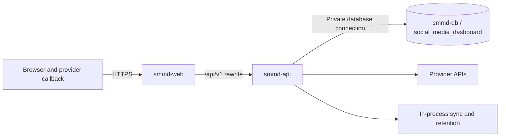

# Render deployment and operations

[Documentation home](README.md) · [Setup/environment reference](SETUP.md) · [Architecture](ARCHITECTURE.md) · [Status](STATUS.md)

This is the current operational handover as of 20 October 2026. The earlier [detailed Render guide](../docs/guides/render-deployment.md) supplies dashboard field-by-field setup; its current instructions are reconciled with the later repairs here. Historical [preparation evidence](../docs/evidence/render-deployment-preparation.md) remains a record of a task that did not deploy. Later deployment/repair observations do not rewrite that history.

## Topology and evidence boundary

| Resource   | Role / recorded address                                                                                              |
| ---------- | -------------------------------------------------------------------------------------------------------------------- |
| `smmd-web` | Next.js Node Web Service; [public website](https://smmd-web.onrender.com) and `/api/v1` proxy                        |
| `smmd-api` | NestJS Node Web Service; [direct health](https://smmd-api.onrender.com/api/v1/health)                                |
| `smmd-db`  | PostgreSQL application database resource, as identified in the task handover; Prisma schema `social_media_dashboard` |

The earlier proposed database name `smmd-postgres` is superseded here by the task-reported `smmd-db`. Database resource name, PostgreSQL database name and schema are different identifiers. Verify database version, region, plan, private connection and deployed commit in Render before a release; this documentation pass did not read the private Render dashboard. Earlier preparation selected Frankfurt; keep interdependent resources in one verified region.

On 20 October 2026, direct API health and [proxied health](https://smmd-web.onrender.com/api/v1/health) both returned 200 with the expected API JSON, and the public sign-in/access-request pages rendered. These checks establish public routing/process reachability. Health does not query the database; they do not establish current authenticated access, provider status, backup recovery or the deployed Git SHA.



## Required service settings

Set **`NODE_ENV=production` on both services**. Use a supported Node 24 LTS patch available on Render and pnpm 11.8.0. Do not copy a dated patch number without verifying availability. Render supplies `PORT`; API uses it before the local `API_PORT` fallback and binds `0.0.0.0`. See [Render Web Services](https://render.com/docs/web-services) and [Node versions](https://render.com/docs/node-version).

Use the repository root as the build root for each service so workspace/lockfile configuration is available. Configure only an approved release branch/commit; latest task baseline is `main` including `9762543` and `20a364f`. The old preparation instruction to deploy `staging` is not proof of current service settings. Pushing this documentation branch is not a deployment instruction.

| Setting        | API service                                                                                                | Web service                                                      |
| -------------- | ---------------------------------------------------------------------------------------------------------- | ---------------------------------------------------------------- |
| Build command  | `pnpm install --frozen-lockfile && pnpm --filter @smd/api prisma:generate && pnpm --filter @smd/api build` | `pnpm install --frozen-lockfile && pnpm --filter @smd/web build` |
| Normal start   | `pnpm --filter @smd/api exec prisma migrate deploy && pnpm --filter @smd/api start:prod`                   | `pnpm --filter @smd/web exec next start -H 0.0.0.0 -p $PORT`     |
| Health path    | `/api/v1/health`                                                                                           | Verify website and proxied health after release                  |
| Origin         | `APP_ORIGIN=https://smmd-web.onrender.com`                                                                 | `NEXT_PUBLIC_API_URL=/api/v1`                                    |
| Database/proxy | Private `DATABASE_URL` targeting the intended DB/application schema                                        | `SMD_API_ORIGIN=https://smmd-api.onrender.com` at build time     |
| Workers        | **`INTEGRATIONS_SCHEDULER_ENABLED=true`**, no `TEST_DATABASE_URL`                                          | No provider credentials                                          |

These command fields use Render's Linux shell syntax (`&&`, `$PORT`), not Windows PowerShell variable syntax. Migration failure must prevent API startup. `start:prod` launches compiled `apps/api/dist/src/main.js` through the production `tsx` dependency; plain `node dist/src/main.js` is not an equivalent command because of extensionless ESM/Prisma imports.

API private configuration also includes reporting timezone, stable account/campaign encryption keys, selected provider client pairs/API versions, optional SMTP and report font. See the complete [environment table](SETUP.md#api-core-variables) and [provider setup guide](../docs/guides/provider-setup-and-migration.md). Configure only the integrations used. Never expose secrets through `NEXT_PUBLIC_*`, screenshots or build logs.

## Same-origin proxy and cookies

The browser must request `https://smmd-web.onrender.com/api/v1/...`. Production [Next.js rewrites](../apps/web/next.config.ts) forward to `SMD_API_ORIGIN` server-side; the API origin value is HTTPS with no `/api/v1`, path, query, fragment or embedded credentials. Next.js records the destination during build, so a hostname change requires updating the value and rebuilding web.

Keep `APP_ORIGIN` exactly equal to the public web origin. Cookies return through that origin; session cookie is `HttpOnly`, `Secure`, `SameSite=Lax`, path `/`. Unsafe requests also need exact Origin and matching CSRF cookie/header. Do not point the production browser URL directly to the API to repair a proxy issue or relax CORS/CSRF. Never set `SMD_E2E_ALLOW_HTTP_API_ORIGIN` on Render.

## Migrations and seed

### Existing installation

1. Identify current API/web commit, migration journal and database target privately. Back up the intended application schema and preserve both encryption keys before release.
2. Review all new migration SQL and compatibility against existing data. Generate Prisma during build; apply committed migrations using `prisma migrate deploy` before the corresponding API starts.
3. Keep applied migration SQL/checksums unchanged. Do not run `migrate dev`, reset, `db push --force-reset`, or ad hoc table deletion in production. A schema-normalization change does not move rows from `public`.
4. Do not run demo preparation. Reseeding the catalogue is a separate deliberate maintenance operation, not a default migration step.

### Fresh empty database

1. Confirm the database is genuinely empty and intended. Set private `DATABASE_URL`, preferably with `?schema=social_media_dashboard` (append with `&` if a query exists). [Prisma config](../apps/api/prisma.config.ts) now adds a missing schema parameter and rejects a conflicting explicit schema.
2. Configure both `SEED_ADMIN_EMAIL` and `SEED_ADMIN_PASSWORD` privately on API for first bootstrap. Temporarily start with:

   ```sh
   pnpm --filter @smd/api exec prisma migrate deploy && pnpm --filter @smd/api prisma:seed && pnpm --filter @smd/api start:prod
   ```

3. Verify migrations, health, login and protected reads. Production seed creates the first Administrator only when none exists and does not reset an existing Administrator; supplying only one seed variable fails explicitly. Catalogue seeding does not create demo campaigns.
4. Remove both seed credentials from Render, restore the normal start command and redeploy through the approved release process. Record only non-secret outcomes.

### Restore migration path

Restore into an identified empty target **before first API start/migration**. Restore the whole application schema, including `_prisma_migrations`, credentials/provenance/audit tables and all current tables, with appropriate managed-role ownership options. Keep existing encryption keys unchanged. Verify restored content before allowing `migrate deploy` to apply outstanding migrations. Never restore over an unknown/non-empty target without a separately reviewed merge/recovery plan.

## OAuth callback registration

Register exact public **web** HTTPS callback URLs in each provider console:

| Flow                   | URL                                                                         |
| ---------------------- | --------------------------------------------------------------------------- |
| All Accounts providers | `https://smmd-web.onrender.com/api/v1/accounts/oauth/callback`              |
| Campaign Meta          | `https://smmd-web.onrender.com/api/v1/integrations/oauth/meta/callback`     |
| Campaign LinkedIn      | `https://smmd-web.onrender.com/api/v1/integrations/oauth/linkedin/callback` |
| Campaign Google family | `https://smmd-web.onrender.com/api/v1/integrations/oauth/google/callback`   |
| Campaign Zoho          | `https://smmd-web.onrender.com/api/v1/integrations/oauth/zoho/callback`     |

Use `INTEGRATION_OAUTH_REDIRECT_URI` for the shared Accounts callback. Campaign flow uses `INTEGRATION_OAUTH_API_ORIGIN=https://smmd-web.onrender.com` and matching `INTEGRATION_OAUTH_ALLOWED_CALLBACK_ORIGINS`. No trailing slash; scheme/host/path must exactly match console registration. A callback route existing does not guarantee a creatable adapter or provider product approval.

Follow the maintained [console setup/migration guide](../docs/guides/provider-setup-and-migration.md) and [Accounts setup](../docs/integrations/account-provider-setup.md). Authoritative provider references: [Meta Pages](https://developers.facebook.com/docs/pages-api/), [Instagram with Facebook Login](https://developers.facebook.com/docs/instagram-platform/instagram-api-with-facebook-login/), [LinkedIn Community Management](https://learn.microsoft.com/en-us/linkedin/marketing/community-management/community-management-overview), [LinkedIn versioning](https://learn.microsoft.com/en-us/linkedin/marketing/versioning), [YouTube Analytics authorization](https://developers.google.com/youtube/analytics/guides/authorization), [Zoho Campaigns API](https://www.zoho.com/campaigns/help/developers/). Confirm current products/scopes and eligible assets before acceptance; local configuration alone is insufficient.

## Release procedure

1. Review the intended release diff and migration/backward compatibility; record exact commits and rollback version. Confirm a recent recoverable backup and custody of both OAuth encryption keys.
2. On an isolated test environment using Node 24/PostgreSQL 18, run relevant release checks from [SETUP](SETUP.md#isolated-test-database-and-commands). Documentation-only changes need documentation checks; application release checks normally include lint, types, unit/integration/E2E and build. Do not run database tests against production.
3. Confirm Render's branch, auto-deploy policy, private configuration, supported Node patch, database availability and same-origin values. For continuous account collection confirm an always-running API and scheduler enabled.
4. Deploy the approved API/web release in a compatible order, with migrations before new API code reads new tables. Check deployment/migration logs without retaining secrets. This task does not execute this step.
5. Read direct/proxied health and the website. With an authorised test account, verify sign-in, reload persistence, protected read, roles, logout, valid/invalid CSRF and report downloads. Use controlled tests that do not create/delete real campaign data just for a smoke check.
6. Verify provider syncs on authorised accounts separately, including safe job statuses and metric coverage; do not infer them from health or OAuth consent. Verify recovery inbox delivery only when authorised/configured.
7. Record timestamp, actual deployed commits, checks and unresolved conditions. Resume scheduled collection monitoring and backup cadence.

## Backup and restore

Database recovery is an operator responsibility. Local [restore verification](../docs/evidence/backup-restore-verification.md) passed historically; a production restore drill remains separate. Dumps contain private user/provider data even though OAuth credentials are encrypted. Keep encrypted backups and stable encryption keys outside Git, with restricted access and a tested retention schedule.

Prisma's `?schema=` connection parameter is not accepted by libpq tools. Use explicit `pg_dump` connection fields or a private libpq-compatible connection without that parameter, and select the application schema separately. Replace the placeholders below before running; password is prompted with `-W` rather than written into the command. Run from a trusted operator machine with PostgreSQL 18 client tools, and store output in a private backup directory **outside the checkout**:

```text
pg_dump -h <source-host> -p 5432 -U <source-user> -W -d <source-database> --schema=social_media_dashboard --format=custom --file=<private-backup-path>
pg_restore --list <private-backup-path>
```

For a drill, provision a **new empty isolated destination**, verify its host/database identity and emptiness, then:

```text
psql -h <restore-host> -p 5432 -U <restore-user> -W -d <new-empty-database> -c "SELECT current_database(), current_user;"
pg_restore -h <restore-host> -p 5432 -U <restore-user> -W -d <new-empty-database> --no-owner --no-acl --exit-on-error <private-backup-path>
```

Use TLS and Render's **external** connection details for a trusted off-platform restore machine; use its private/internal database URL for the deployed API. Apply your managed database's required TLS settings privately. Do not add `--clean` or direct restore to the live source. Keep API undeployed/stopped for the new target until verification is complete.

Verify all application tables and migration journal, row counts/content fingerprints, usable encrypted credentials with preserved keys, health, authenticated campaign/analytics reads and reports. Do not infer completeness from old evidence that counted fewer tables before later migrations. Record backup checksum/size, restore exit status, environment class and checks without connection strings. Do not delete production/public remnants as routine cleanup.

## Monitoring, maintenance and continuous collection

Monitor API/web availability, deploy failures/restarts, database storage/connections/backups, provider auth failures, job age/progress, `PARTIAL`/`FAILED` chunks, latest successful history fetch and per-metric coverage. Alert on persistent `QUEUED` jobs and `PROVIDER_DATA_RETENTION_SWEEP_FAILED`. Health checks are process checks; include authenticated database reads in an approved monitoring method.

Meta job leases are five minutes with 30-second heartbeats; durable chunks resume after restart. Jobs expire 30 days after completion. Automatic transient chunk retries use 1/5/15-minute delays, at most four attempts. See [architecture](ARCHITECTURE.md#scheduling-leases-retries-and-retention) before tuning concurrency. Non-Meta account sync exclusion/OAuth refresh is process-local; do not claim safe cross-instance account refresh merely because Meta/campaign leases exist.

The in-process account timers need API uptime. Explicitly enable `INTEGRATIONS_SCHEDULER_ENABLED=true`; **false also blocks manually queued Meta history work**. After the setting repair, existing Instagram bootstrap resumed without reconnecting. The separate canonical retention sweep runs independently of this flag but still requires API uptime. `TEST_DATABASE_URL` must not exist on deployed services.

Schedule `pnpm --filter @smd/api session:cleanup` and `pnpm --filter @smd/api recovery:cleanup` through an approved operational schedule; they remove stale records only beyond their 30-day retention windows. They are not automatically configured Render cron jobs by this repository. Check provider policy/API-version changes and credential expiry; audit the older unmanaged LinkedIn values identified in ADR-012.

### Free-tier constraints

[Render Free service documentation](https://render.com/docs/free), checked 20 October 2026, states that idle Free web services sleep after 15 minutes; Free PostgreSQL expires after 30 days and lacks backups; Free web services block outbound SMTP ports 25/465/587. A sleeping API cannot promise scheduled history collection. Use an approved always-running service and durable database/backups for continuous collection. Plan changes are separate operator actions.

Do not disable the scheduler as a general Free-tier workaround and then tell users to run Meta sync manually: that manual action enqueues the same disabled worker. Enabled workers can run while the service is awake, but uptime gaps can permanently miss provider-fetchable history. Production recovery email requires a plan/SMTP path that actually works or a separately implemented/approved delivery adapter; no HTTPS mail adapter is established by current source.

## Rollback

If a release fails, choose the recorded compatible prior API/web builds through Render's release controls. Check compatibility with the **already applied** schema first. Application rollback does not reverse PostgreSQL migrations or restore lost data. Do not delete tables or modify migration checksums to simulate rollback. Use a reviewed forward repair when appropriate; database recovery requires a verified backup, controlled target and separate cutover plan. Preserve encryption keys and inspect pending jobs before re-enabling collection.

## Incident-based troubleshooting

| Symptom / recorded incident                                          | Diagnosis and safe response                                                                                                                                                                                                                                                                                                                                                                                            |
| -------------------------------------------------------------------- | ---------------------------------------------------------------------------------------------------------------------------------------------------------------------------------------------------------------------------------------------------------------------------------------------------------------------------------------------------------------------------------------------------------------------- |
| Fresh deploy P3018 / PostgreSQL 3F000 at password-recovery migration | Bare URL applied early unqualified SQL in `public`, while later SQL expected `social_media_dashboard`. Commit `9762543` normalises missing schema in Prisma config without editing old SQL. Follow [exact recovery conditions](../docs/evidence/render-fresh-migration-recovery.md); existing failed application-schema objects or real `public` data require separate review. Do not reset/blindly `migrate resolve`. |
| Meta jobs remain queued                                              | Historical Render scheduler was false. Set true, deploy configuration and confirm worker progress while API is running; no disconnect/reset required. Check test URL flag and migrated job tables too.                                                                                                                                                                                                                 |
| YouTube `UNSUPPORTED_PROVIDER_METRIC`                                | Before `20a364f`, top-video output included content watch time outside the approved catalogue. Deploy the reviewed fix; daily account watch time remains. Do not add an arbitrary metric/migration to bypass validation.                                                                                                                                                                                               |
| Zoho sync succeeds, selected year empty                              | Check actual campaign send dates and organisation. Historical task observation found newest sends in November 2025; that explains that selected 2026 report only. A transient Render log-viewer fetch failure was not proof of Zoho permission failure.                                                                                                                                                                |
| Facebook report empty after reconnect                                | Latest handover says disconnected at last verification. Check eligible Page, consent/scopes and actual sync/coverage; do not claim a verified reconnect from old consent evidence.                                                                                                                                                                                                                                     |
| LinkedIn configured but unavailable                                  | Verify Community Management review/product access, Page admin, exact scopes, supported API version and live sync. Current approval was not re-established here.                                                                                                                                                                                                                                                        |
| API works directly, website login/write fails                        | Verify production web rebuild with correct `SMD_API_ORIGIN`, browser `/api/v1`, exact `APP_ORIGIN`, production cookie flags and CSRF; do not weaken guards.                                                                                                                                                                                                                                                            |
| Cold/slow first request                                              | Check sleeping services and deployment logs; retry after wake. Health success still does not prove DB/provider success.                                                                                                                                                                                                                                                                                                |
| Recovery says requested, no email                                    | Generic acknowledgement does not prove delivery. Check SMTP config, sender and network/plan restrictions with an authorised inbox test.                                                                                                                                                                                                                                                                                |

Historical source: [account sync repairs](../docs/evidence/render-account-sync-repairs.md), [migration recovery](../docs/evidence/render-fresh-migration-recovery.md), [preparation](../docs/evidence/render-deployment-preparation.md). Current unresolved acceptance stays in [STATUS](STATUS.md).
