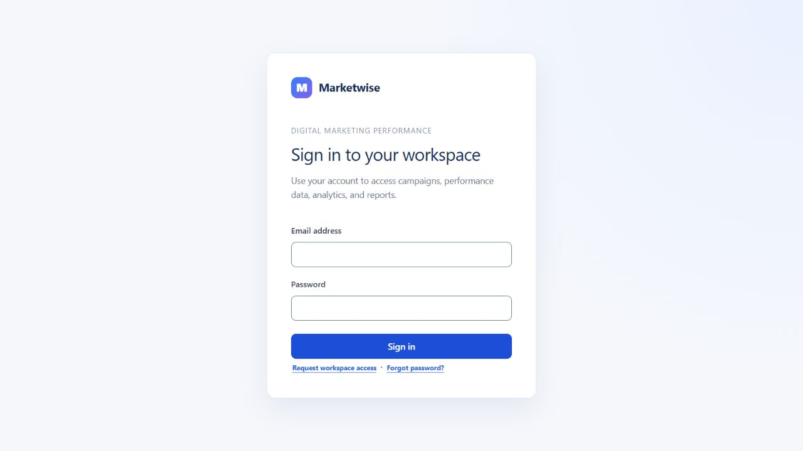

# Marketwise user guide

[Documentation home](README.md) · [Setup for administrators](SETUP.md) · [Deployment](DEPLOYMENT.md) · [Current limitations](STATUS.md)

This guide describes the current interface at source revision `20a364f`. Your Administrator supplies the website address and access. The recorded production website is [Marketwise](https://smmd-web.onrender.com). A sleeping service may take time to open; if a request fails, allow it to wake and retry before changing your account or provider settings.

## Request access, sign in and recover a password

1. Open the website. Existing users enter their email/password and choose **Sign in**.
2. New users choose **Request workspace access**, enter their full name, email and a password of at least ten characters, then submit. This sends an application for this organisation, not an immediate sign-in. Wait for an Administrator to approve it and assign a role. Use your chosen credentials after approval.
3. If an Administrator sends an invitation, open it privately, enter the invited email, your name and a password, and submit. Invitations work once, expire after seven days, and can be revoked. They do not replace an existing account. The app creates a copyable invitation link; it does not send invitation email automatically.
4. If you forget your password, choose **Forgot password?**, enter the account email and submit. The acknowledgement is deliberately generic. For an active account with delivery configured, open the recovery link and choose a new password. The link expires after 30 minutes and works once. Then sign in again. Request a new link if the old one is expired/used.
5. In **My profile**, update your display name or change your password using the current password. A successful password change signs out active sessions; sign in again with the new password.

Captured through browser automation from the public site on 20 October 2026. The fields are blank; no account credentials, provider data or OAuth URLs are included. Registration page text was also inspected without submitting a request. Authenticated screenshots were not obtained in this pass; old design mockups are not presented as current screens.

**Administrator note:** development recovery links appear only in the API terminal; deployed recovery needs working mail delivery. End users should contact their Administrator when no message arrives. Never share reset/invitation links in screenshots or public support messages.

## Roles and navigation

| Action                                                                                                                               | Administrator | Marketing Officer | Management |
| ------------------------------------------------------------------------------------------------------------------------------------ | ------------- | ----------------- | ---------- |
| Read campaigns, datasets, analytics, account reports and download reports                                                            | Yes           | Yes               | Yes        |
| Create/edit campaigns, enter/correct performance, import files, replace manageable datasets and save column details                  | Yes           | Yes               | No         |
| Connect/reconnect accounts and request sync                                                                                          | Yes           | Yes               | No         |
| Manage campaign connection configuration/mappings                                                                                    | Yes           | No                | No         |
| Manage users/access/invitations, catalogue, currency and KPI targets                                                                 | Yes           | No                | No         |
| Archive/restore/permanently delete eligible campaign data, delete manageable datasets/import staging, disconnect/delete account data | Yes           | No                | No         |
| Edit own name/change own password                                                                                                    | Yes           | Yes               | Yes        |

Management can filter, compare and export existing information. Export/comparison does not grant permission to alter source data. The server enforces these permissions even when a button is hidden. Historical datasets may have additional protection; follow the screen's capability message.

The sidebar groups **Accounts**, **Campaigns**, **Data**, **Reports** and **Administration**. **Overview** presents campaign performance. Accounts contains social insights/comparison, email reports and Connections. Campaigns includes campaign management/analytics and targets. Data contains file workflows and Performance data. Administration is visible to Administrators. On a phone use **Menu**; keyboard users can use **Skip to content**. URL selections and browser Back/Forward retain supported workspace context.

## Create, view and edit a campaign

1. Open **Campaigns** and choose **Create campaign**. Supply a name and start date; end date is optional and cannot be earlier than start date.
2. Select channels/platforms when you want canonical daily performance. These associations are optional for a campaign used only to organise files. The create form assigns the signed-in user as responsible user.
3. Save once and wait for the result. Open the new campaign from the directory. Campaign detail shows the joined campaign-data view when datasets exist; **Configure columns** exposes its source choices. **Manage campaign files** opens upload/file management.
4. Choose the campaign's edit action to change its name, description, objective, target audience, dates, status, budget or notes. Save and wait for saved/error feedback. The current edit screen keeps the responsible-user assignment and channel/platform links intact; it does not offer controls to change them.
5. Administrator Delete/archive actions remove a campaign from normal analytics while retaining history. Restoration and permanent deletion are separate operations described below.

For manual daily performance, open **Data → Performance data**, select the campaign/platform and calendar date, and enter applicable **raw** values. Use the exact source numbers. Leave unknown values missing; enter zero only when the source confirms zero. Derived rates such as CTR are calculated by the system. Correct an existing daily record rather than creating a duplicate for the same campaign/platform/date. Integration-managed data has ownership rules that may require a deliberate change of management before manual correction.

## Choose the appropriate import workflow

Marketwise preserves two file workflows. A **campaign dataset** keeps arbitrary source columns and rows together for viewing/joining/export. The **structured KPI importer** maps approved raw metrics into daily campaign performance used by Overview and KPI reports. Uploading a table does not automatically turn every column into a canonical metric.

Both support CSV, tabular JSON and XLSX, up to 10 MiB per file. Convert old `.xls` files in a spreadsheet application to CSV/XLSX; changing an extension is not conversion. For file-first datasets, parser limits also include 100,000 rows, 500 columns, one million cells and bounded expanded workbook size. The date-join screen has a smaller limit described below.

### Import and manage campaign datasets

1. Open **Data** or a campaign's **Manage campaign files**. Choose the intended campaign first. If needed, use **Create campaign** / **Create and select campaign** with its name/start date.
2. Under **Upload a dataset**, select a CSV/XLSX/JSON file and use the preview action. Every upload remains a separate dataset even when dates/columns overlap.
3. If the workbook offers multiple worksheets, choose the intended **Worksheet**. Review the sample, column count and row count. If **Saved column labels** offers a matching template, select it and choose **Apply template**; otherwise keep current labels.
4. Confirm the import using the displayed confirmation action. Wait for the dataset card and saved row count before leaving. If an exact file/worksheet already exists in that campaign, choose **View existing dataset**, or deliberately choose replacement if permitted. Repeated upload does not silently append/merge source rows.
5. Open the dataset. Expand source rows when needed, search, use page controls, and select date/chart fields when offered. Row filters apply through the API, not just to the page in view. Revision checks can require you to reload after another edit.
6. For a corrected file, use the dataset's replacement action. Review the target and replacement preview and confirm. A failed replacement leaves the current dataset available; a stale version must be refreshed before trying again.
7. Historical imports labelled protected remain viewable but cannot be replaced/deleted through this workflow. Ask an Administrator about their provenance instead of bypassing the restriction.

### Save column details

1. Open a manageable dataset and its column-details controls. Identify each column by original source name and preview values.
2. Edit its display label, meaning and unit where useful. For example, label a source `Primary` column as the actual metric only after checking what the file measures. This is descriptive metadata, not a formula or data conversion.
3. Choose **Save column details**. Wait for the saved state; leaving a field does not by itself save it. Controls are disabled during the request. On a failed save, your typed values remain available so you can retry after correcting the issue.
4. Use the template-save action to name reusable column-label rules for matching headers. Templates are associated with the creating user and matching source headers; preview their application on each new import.

### Map a structured KPI import

Use the existing guided KPI import when you want source metrics included in campaign Overview/analytics. Its sequence is **Upload file → Confirm details → Review and import → View results**; the [detailed import guide](../docs/guides/imports.md) remains the reference for this separate workflow.

1. Select the file and choose **Next**. Select a worksheet if prompted.
2. Confirm campaign, platform and date fields. Open **Change details / review fields** to review mapping suggestions and optional display names. Suggestions use recognised aliases or previously completed mappings; confirm them against the source.
3. Map the date field to the calendar record date and only appropriate source numeric fields to approved raw metrics. Do not map a source percentage directly into a calculated KPI. Exclude source-only columns. Email files with multiple campaign names require the appropriate source-to-local campaign mappings.
4. Choose an action: create/add new dates rejects collisions; **Add missing metrics to matching dates** uses merge semantics. Equal existing values stay unchanged; differing values are conflicts, not silent overwrites. Rows with the same campaign/platform/date can aggregate into one canonical daily record, so source-row and written-record counts may differ.
5. Choose **Next** to check. Review accepted, unchanged, excluded and conflicting rows. Acknowledge excluded rows explicitly when accepting a partial import. Correct context/mappings and recheck when necessary.
6. Choose **Import data** only after review. Then choose **View results** for the accepted campaign/platform/date scope and download its PDF if needed. Results can include other saved data in that scope, not only this file. For multiple campaigns, use each result link.

**Back** preserves in-memory choices. Leaving/refreshing an unfinished guided import warns because it cannot resume the draft durably. Import history preserves staging/provenance. A completed checksum blocks repeating the file; archived daily records still occupy their keys. Admin **Delete import** applies only to eligible uncommitted staging, not completed/processing or referenced batches.

## Join datasets by date and export

1. Open a campaign's data view, which shows its joined-by-date table, or the dataset workspace's join section. Expand **Configure columns**.
2. Select the campaign's source datasets and a **Date column** and **Value column** from each. The view initially selects eligible source choices; verify them. Each source must have both fields and **no more than 10,000 rows**.
3. Review the result. The join includes dates found in any selected source. Missing matches are blank. Repeated same-date rows remain separate, aligned by occurrence order within each source; they are not summed or expanded into every possible pair. Blank date keys are omitted.
4. ISO dates/timestamps such as `2026-01-01T01:00:00` match their `2026-01-01` calendar key. Other text keys match exactly: the app does not guess whether `01/02` means January 2 or February 1. Standardise ambiguous date formats in the source export when needed.
5. Select a numeric metric for the chart. Missing/non-numeric values remain gaps; repeated dates remain separate points. The joined chart calculates no totals, conversions or rates.
6. Choose **Download joined CSV** for all joined rows, or **Print / Save PDF** to open the printable table/chart and use your browser's print dialog to save PDF. Allow the print window if blocked. Print output includes all joined rows across pagination.

The join is a browser view; the original datasets remain separate. To retain a combined dataset, download the joined CSV, review it, and intentionally import it as a new dataset. For a single dataset, use its **Export CSV** / **Export PDF** controls or Reports' dataset cards. Single-dataset exports and joined-view browser printing are different report paths.

## Connect and report on provider accounts

An Administrator must first configure the server/provider app. **API setup needed** is a configuration/access issue to refer to that Administrator; end users do not enter client secrets or encryption keys in account screens. Instructions for those tasks are in [provider setup](../docs/guides/provider-setup-and-migration.md), not in the consent workflow below.

1. As Administrator or Marketing Officer, open **Accounts**, choose the provider's **Connect** action and complete provider consent with the identity authorised for the intended asset.
2. Check the returned account card matches the correct Page/account/channel/organisation. Consent can succeed without eligible assets or reporting access. Do not assume the login's personal profile is the reporting account.
3. Select the account and report date range. Choose **Sync available history** for Meta or **Sync this period** where shown. Wait for the saved update/job status. Existing saved reports remain readable while a Meta job runs.
4. Inspect coverage, error/caveat messages and the successful-update timestamp. Select a report metric/content view and use **Download PDF** for the selected account/period.
5. For comparison, use the Accounts comparison view and select the accounts/date range. Read provider-specific labels and completeness; a similarly named metric on another provider may have a different definition. An unavailable comparison is not zero change.
6. Reconnect only when access has expired or the screen requests renewed consent. If a job is merely queued, contact the Administrator to check the scheduler/API uptime before disconnecting. Disconnecting is not required to repair a queued worker.

| Provider       | What the user needs / report meaning                                                                                                                                                    |
| -------------- | --------------------------------------------------------------------------------------------------------------------------------------------------------------------------------------- |
| Instagram      | Professional Business/Creator account linked to a Facebook Page and an identity with required access. Organic account metrics and retained post snapshots are separate from ads.        |
| Facebook       | Eligible Page with insight access. A personal profile alone is insufficient. Latest historical evidence does not establish sync after reconnection.                                     |
| YouTube        | Eligible Google identity/channel, enabled Data and Analytics APIs and consent access. Daily account watch time remains supported; video output follows the narrower approved catalogue. |
| LinkedIn       | Organisation Page administrator and approved Community Management products/scopes. Current live approval/sync was not confirmed in this documentation pass.                             |
| Zoho Campaigns | Correct regional account and organisation. Use the separate email reporting area; campaign totals are cumulative snapshots selected by send date.                                       |

For paid campaign reporting, an Administrator configures **Accounts → Connections** and mappings from external advertising campaigns to local campaign-platforms. That is separate from organic account connection. Marketing Officers can run permitted syncs; Administrators manage credentials, mappings and auto-sync settings. A mapping cannot be removed during a running sync; removing it preserves recorded history.

## Dates, coverage and sync states

Use `from`/`to` calendar dates deliberately and read the report's period label. Campaign defaults use the latest eligible saved record and preceding 29 days; with no data they use today in the configured reporting timezone. Your explicit date selections are preserved. Account default windows and provider fetch availability are separate from campaign defaults.

For Meta, a report can cover up to **365 inclusive dates**. Instagram can fetch only the latest **90 dates** through this app's history planner; Facebook annual jobs use up to 30 days per chunk and metric availability varies. Older collected values can remain reportable until local expiry even when the provider no longer supplies them. Selecting a year does not manufacture earlier history.

| State                          | Meaning / action                                                                                                              |
| ------------------------------ | ----------------------------------------------------------------------------------------------------------------------------- |
| Queued                         | Work accepted but waiting for the API worker; if persistent, Administrator checks scheduler and uptime.                       |
| Running                        | Fetch sections are progressing; continue using saved data.                                                                    |
| Succeeded / completed          | Planned fetch work finished; check saved metric coverage because empty provider results are possible.                         |
| Partial                        | Some work/values are available; inspect failed sections and coverage, then retry or renew consent as directed.                |
| Failed                         | Inspect safe error message/code; correct provider access/configuration before retrying.                                       |
| Cancelled                      | Job stopped, for example after an account lifecycle change.                                                                   |
| No saved history / unavailable | No eligible observations for that metric/period, expired data, unsupported fields or missing history; do not read it as zero. |

Progress is completed fetch sections, not percentage of dates with data. Zero is a real observation. Gaps stay blank/unavailable; partial additive totals carry coverage labels, and comparisons require compatible complete data. Current follower counts are snapshots on their retrieval date, not historical follower values for every selected date. Daily reach across a period is not a deduplicated count of unique people. Meta post snapshots last 90 days, so an annual account report is not a complete annual post ranking.

### Zoho email report dates

Open the email reporting area, select Zoho and a period containing the **sent dates** of campaigns you want. Sync, then inspect campaign names/send dates and cumulative totals. An old campaign fetched today still belongs to its original send-date report. A successful sync can therefore show an empty selected period.

Task-supplied historical verification observed the newest campaigns on 28–29 November 2025, explaining an empty selected 2026 report. Those dates are an observation from that check, not a product cutoff or a claim about Zoho today. Check the current organisation and actual campaign sends before concluding that a blank report is a permission failure.

## Campaign reports, targets and settings

Overview and campaign analytics use backend KPI calculations. Adjust campaign/dates; **More filters** exposes channel, platform, metric and applicable target period. Choose the intended trend metric. Reports normally omit unavailable metrics; enable **Include unavailable metrics** when you want them shown. Report preview and Download PDF use the selected campaign scope. They do not combine organic Accounts or cumulative Zoho totals into campaign KPIs.

An Administrator creates targets by approved KPI, scope and period; overlapping targets for the same scope/period are rejected. `NO_DATA` means there is no actual data to evaluate; `NO_TARGET` means actual data exists but no target applies. Administrators choose reporting currency under Settings. It labels existing amounts and does not convert them; verify source currencies before comparing spend.

## Archive, restore and intentional deletion

Administrator archive actions hide campaigns/daily records from normal analytics and exports. In **Administration → Archive**, search the relevant type and restore. Restore a parent campaign before an individually archived record. Restoring the campaign does not automatically restore individually archived records.

For intentional permanent deletion, choose **Review deletion**, review current dependency counts/blockers, and resolve mappings first if instructed. Running sync must finish before mapping removal. Type the exact identity shown and confirm within five minutes. Changed dependencies require a new preview. Permanent deletion has no undo; retained imports/audits and daily-key tombstones are provenance, not a restoration facility.

Account **disconnect** stops updates and clears credentials while permitted saved history remains. Account **delete data** is a separate Administrator action after disconnect. Do not disconnect/delete accounts to fix an empty report without first checking dates, coverage and errors.

## Getting help

Report the screen, selected account/campaign, date range, safe error code and approximate time. Omit passwords, cookies, OAuth URLs, reset/invitation links and private source rows. Ask an Administrator to check [deployment troubleshooting](DEPLOYMENT.md#incident-based-troubleshooting). Current provider approvals, continuous collection, mail delivery and production recovery checks are tracked in [STATUS](STATUS.md).
